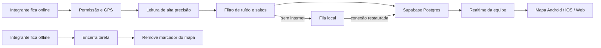

<div align="center">
  

  # MotoTrack

  **Rastreamento operacional de equipes em tempo real, com privacidade, presença e gestão por níveis de acesso.**

  [](https://expo.dev/)
  [](https://reactnative.dev/)
  [](https://www.typescriptlang.org/)
  [](https://supabase.com/)
  [](#versão-e-builds)
  [](#licença-e-uso)
</div>

---

## O produto

O MotoTrack permite que equipes acompanhem, em um único mapa, apenas os integrantes que decidiram ficar online. Cada marcador recebe foto, apelido e atualização em tempo real; ao selecioná-lo, o app apresenta identificação, contato, distância, velocidade e atalhos para chamada, WhatsApp e rota.

O projeto foi construído para Android, iOS e web com a mesma base em React Native/Expo. O backend usa Supabase para autenticação, banco, Storage, políticas de acesso, Realtime e operações administrativas protegidas.

> A localização nunca é compartilhada silenciosamente: o integrante precisa ativar o rastreamento. Ao ficar offline, o marcador é removido do mapa da equipe.

## Destaques

- Rastreamento em primeiro e segundo plano no aplicativo nativo, com captura de até 1 segundo durante movimento.
- Atualização por Supabase Realtime com consulta de recuperação a cada 15 segundos.
- Mapa vetorial MapLibre com o estilo OSM Liberty do OpenFreeMap, sem chave paga de mapas.
- Exibição exclusiva de membros online e com posição recente.
- Marcadores com foto, apelido e estado da posição.
- Filtro de ruído, precisão e saltos do GPS para reduzir deslocamentos laterais quando o aparelho está parado.
- Velocidade em km/h combinando o sensor Doppler do aparelho com uma janela móvel de distância/tempo.
- Fila local para reenviar posições após perda de conexão.
- ID público único gerado automaticamente no formato `ABC12345`, pesquisável em equipe e administração.
- Cadastro com limites, normalização e validação também no servidor e no banco.
- Temas claro e escuro persistidos no aparelho.
- Administração master com usuários agrupados por equipe e busca interna por nome, apelido, e-mail ou ID.
- Administração de grupo isolada por equipe, sem acesso administrativo a outros grupos.
- Aprovação de novos integrantes antes do acesso aos dados do grupo.
- Fotos de perfil e logos armazenados em buckets privados com URLs temporárias e sincronização de alterações.
- Formulários móveis preparados para teclado, rolagem automática e preenchimento de e-mail, telefone e senha.

## Perfis e permissões

| Perfil | Escopo | Permissões principais |
| --- | --- | --- |
| Integrante | Própria equipe | Ficar online/offline, ver equipe, mapa e perfis, editar dados pessoais |
| Admin da equipe | Própria equipe | Aprovar, recusar, expulsar e promover administradores do mesmo grupo |
| Admin master | Plataforma | Criar e editar equipes, usuários, códigos, logos e administradores responsáveis |

As políticas RLS continuam valendo mesmo que alguém tente acessar o Supabase fora da interface. Usuários pendentes ficam isolados até a aprovação; administradores de equipe não podem administrar outros grupos; a conta master é protegida contra alteração pelas rotas comuns.

## Como o rastreamento funciona



No Android/iOS, a coleta usa `Accuracy.BestForNavigation`, intervalo solicitado de 1 segundo e deslocamento mínimo de 1 metro durante movimento. O filtro considera precisão horizontal, ruído acumulado e saltos fisicamente improváveis. A velocidade prioriza o sensor do GPS quando válido e usa uma janela móvel de aproximadamente 3–6 segundos como conferência e alternativa. Depois de confirmar que o aparelho permaneceu no mesmo raio, o valor volta para `0 km/h`; quando parado, o envio é reduzido para aproximadamente 10 segundos.

O intervalo é uma solicitação ao sistema operacional, não uma garantia absoluta: Android e iOS podem reduzir a frequência conforme sinal, economia de bateria, fabricante ou execução em segundo plano. O mapa recebe as posições aceitas pelo Supabase Realtime e considera online apenas quem compartilhou uma posição recente.

Na web, a geolocalização exige HTTPS ou `localhost` e funciona enquanto a página estiver aberta. Se a permissão continuar concedida, o compartilhamento é retomado após recarregar a página para usuários ainda marcados como online.

## Administração por equipe

O painel master foi desenhado para continuar utilizável quando a plataforma tiver muitas equipes e usuários:

1. Cada equipe aparece como um grupo independente, com código, tag, administradores e total de integrantes.
2. O grupo pode ser expandido somente quando o master precisar consultar seus membros.
3. A busca acontece dentro da equipe selecionada e aceita nome, apelido, e-mail ou o ID público `ABC12345`.
4. Cada resultado mantém as ações de edição e exclusão, além de função e estado da conta.
5. Contas sem vínculo aparecem em uma seção separada de pendências.

O administrador de uma equipe continua limitado ao próprio grupo. Somente o master visualiza e administra a estrutura completa da plataforma.

## Arquitetura

```text
MotoTrack/
├── assets/                  ícone e recursos visuais
├── src/
│   ├── app/                 rotas, autenticação, abas e painéis administrativos
│   ├── components/          mapa e componentes de interface reutilizáveis
│   ├── constants/           tokens visuais e estilo do mapa
│   ├── hooks/               consultas, polling e assinaturas Realtime
│   ├── services/            Supabase, perfis, administração e rastreamento
│   ├── stores/              sessão, tema e estado de localização
│   ├── types/               contratos do domínio
│   ├── utils/               distância, datas e estado da posição
│   └── validations/         limites e esquemas Zod
└── supabase/
    ├── migrations/          schema, constraints, RLS, Storage e Realtime
    └── functions/           operações administrativas privilegiadas
```

### Stack

- Expo SDK 57, React Native 0.86, React 19 e Expo Router.
- TypeScript, React Hook Form e Zod.
- Zustand com AsyncStorage para estados persistidos.
- TanStack Query para cache, polling e sincronização.
- Supabase Auth, Postgres, Storage, Realtime e Edge Functions.
- MapLibre Native e MapLibre GL Web com OSM Liberty/OpenFreeMap.
- Expo Location, Task Manager, NetInfo e Secure Store.

## Preparando o ambiente

### Requisitos

- Node.js LTS e npm.
- Uma conta e um projeto no Supabase.
- EAS CLI para builds na nuvem, quando necessário.
- Android Studio/Xcode somente para builds nativos locais.

### Instalação

```bash
git clone https://github.com/oLazaroCS/MotoTrack.git
cd MotoTrack
npm install
```

Crie o arquivo local de ambiente a partir do exemplo:

```bash
cp .env.example .env
```

No Windows PowerShell:

```powershell
Copy-Item .env.example .env
```

Preencha somente as credenciais públicas do cliente:

```env
EXPO_PUBLIC_SUPABASE_URL=https://SEU-PROJETO.supabase.co
EXPO_PUBLIC_SUPABASE_ANON_KEY=sua-chave-publishable-publica
```

Nunca adicione `SUPABASE_SERVICE_ROLE_KEY`, tokens do GitHub, senhas ou o segredo de bootstrap ao aplicativo ou ao Git.

## Configurando o Supabase

Vincule o projeto e aplique todas as migrações na ordem registrada:

```bash
npx supabase login
npx supabase link --project-ref SEU_PROJECT_REF
npx supabase db push
```

Publique a função administrativa com verificação JWT habilitada:

```bash
npx supabase functions deploy admin-users
```

As variáveis `SUPABASE_URL`, `SUPABASE_ANON_KEY` e `SUPABASE_SERVICE_ROLE_KEY` são fornecidas automaticamente à Edge Function pelo ambiente hospedado. O segredo de bootstrap, quando usado durante a implantação inicial controlada, deve existir somente no ambiente do Supabase e ser removido após a criação do primeiro master.

## Executando

```bash
# Servidor de desenvolvimento
npm run start

# Web
npm run web

# Projeto nativo Android
npm run android
```

O MapLibre e o rastreamento em segundo plano contêm código nativo. Por isso, o Expo Go não representa o funcionamento completo do projeto. Use um Development Build:

```bash
npx eas-cli build --profile development --platform android
```

## Builds

Os perfis estão definidos em `eas.json`:

```bash
# APK interno para testes
npx eas-cli build --profile preview --platform android

# Produção Android
npx eas-cli build --profile production --platform android

# Produção iOS
npx eas-cli build --profile production --platform ios
```

No Android 11 ou superior, o sistema pode abrir uma segunda tela para a permissão **Permitir o tempo todo**. Sem essa autorização, o sistema operacional pode interromper atualizações em segundo plano.

## Versão e builds

A versão atual é **1.1.0**:

| Campo | Valor | Finalidade |
| --- | --- | --- |
| `expo.version` | `1.1.0` | Versão visível ao usuário |
| `package.json` | `1.1.0` | Versão do projeto JavaScript |
| Android `versionCode` | `2` | Identificador crescente do pacote Android |
| iOS `buildNumber` | `2` | Identificador crescente do pacote iOS |

A tela **Configurações** lê `expo.version` automaticamente; portanto, não existe mais um texto `1.0.0` fixo na interface. Em novas entregas, altere a versão semântica em `app.json` e `package.json`. Os builds de produção usam `autoIncrement` no EAS para manter o número interno crescente.

## Comandos de qualidade

| Comando | Finalidade |
| --- | --- |
| `npm run typecheck` | Verifica os contratos TypeScript sem gerar arquivos |
| `npm run lint` | Executa a análise estática do Expo/ESLint |
| `npx expo export --platform all` | Confirma o empacotamento web, Android e iOS |
| `npx expo-doctor` | Verifica compatibilidade das dependências Expo |

## Segurança e privacidade

- O `.env` real é ignorado pelo Git; somente `.env.example` é versionado.
- A service role existe apenas na Edge Function hospedada.
- Operações administrativas exigem usuário autenticado e conferência de função.
- IDs de membros são normalizados e globalmente únicos no banco.
- Nome, apelido, telefone, senha e códigos possuem limites no cliente, servidor e Postgres.
- Telefones são armazenados apenas com dígitos e validados entre 10 e 15 caracteres.
- Buckets de fotos e logos não dependem de URLs públicas permanentes.
- A leitura de avatares é autorizada apenas para o próprio usuário, master ou membros ativos da mesma equipe.
- O banco rejeita velocidades negativas ou acima do limite de segurança de `80 m/s`.
- O mapa esconde integrantes offline e posições vencidas.

Antes de disponibilizar o produto comercialmente, revise a política de privacidade com orientação jurídica, defina o período de retenção e documente uma base legal adequada para o tratamento de localização.

## Solução de problemas

<details>
<summary><strong>O GPS funciona, mas o membro não aparece no mapa</strong></summary>

Confirme que a conta está ativa, pertence à mesma equipe, tocou em **Ficar online** e enviou uma posição nos últimos dois minutos. Também verifique as políticas RLS e se o Realtime está habilitado para `driver_locations`.
</details>

<details>
<summary><strong>A localização não funciona na web</strong></summary>

Abra o site por HTTPS ou `localhost`, libere a localização no ícone ao lado do endereço e recarregue a página. Navegadores bloqueiam geolocalização em origens HTTP comuns.
</details>

<details>
<summary><strong>O rastreamento para quando o Android fica em segundo plano</strong></summary>

Use um Development Build/APK, conceda **Permitir o tempo todo** e revise as otimizações de bateria do fabricante. O Expo Go não cobre integralmente a tarefa nativa usada pelo MotoTrack.
</details>

<details>
<summary><strong>A velocidade não zera ou apresenta um valor impossível</strong></summary>

Instale a versão mais recente do APK e desligue/ligue o compartilhamento uma vez. A versão 1.1.0 atualiza automaticamente a configuração da tarefa existente, rejeita leituras inválidas, confirma a parada por deslocamento e mantém uma constraint equivalente no banco.
</details>

<details>
<summary><strong>O teclado cobre o campo de senha no Android</strong></summary>

Use um APK gerado com `softwareKeyboardLayoutMode: resize`. A tela de login também usa ajuste de altura e rola automaticamente até a senha quando o campo recebe foco.
</details>

<details>
<summary><strong>As fotos dos outros integrantes não aparecem</strong></summary>

Confirme as policies do bucket `avatars`. O app transforma o caminho privado salvo no perfil em uma URL temporária e mantém um cache curto para evitar requisições excessivas.
</details>

## Licença e uso

Projeto proprietário e repositório privado. O código, identidade visual e documentação não podem ser redistribuídos ou utilizados fora da autorização do proprietário.

---

<div align="center">
  <strong>MotoTrack</strong><br />
  Presença real. Equipe conectada. Operação em movimento.
</div>
